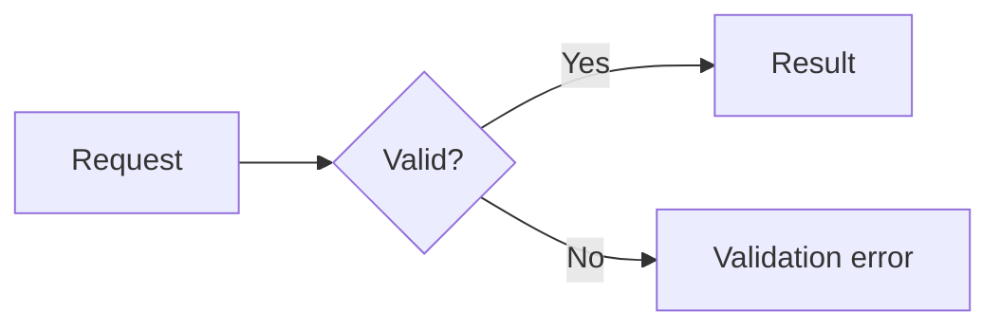
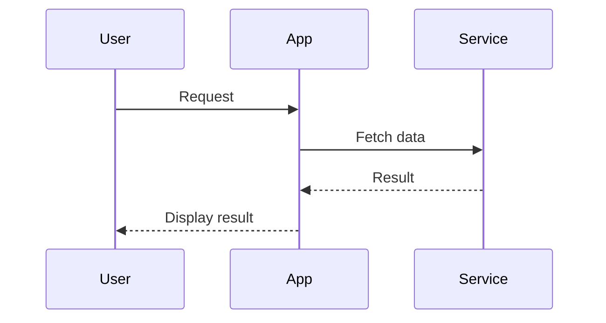

# Mermaid diagrams for Codex

Create readable Mermaid diagrams grounded in the user's requested scope and available evidence. Use the current session's tools; this skill does not install a renderer or MCP server.

## Choose scope and evidence

- Follow applicable AGENTS.md instructions and inspect the current implementation before diagramming this project's behavior.
- Choose flowcharts for processes or architecture, sequence diagrams for interactions, class diagrams for code structure, ER diagrams for data relationships, state diagrams for transitions, and Gantt charts for schedules.
- Infer sensible detail and orientation from the request. Ask only when missing information materially changes the result.
- Distinguish implemented behavior from proposed designs. Label assumptions rather than inventing components, relationships, or error paths.
- For database diagrams, verify keys, nullability, uniqueness, and constraints before assigning cardinality. Local SQL and schema documentation do not prove the deployed database state.
- In this project, trace relevant Flutter screens, providers, services, and Supabase definitions. Preserve domain terminology from AGENTS.md.

## Write and refine

- Use stable, simple node identifiers and concise human-readable labels. Quote labels containing punctuation when needed.
- Keep each diagram focused. Split an overcrowded architecture or schema into an overview and focused diagrams when that improves understanding.
- Prefer readable direction and grouping over decorative styling. Do not rely on color alone to convey meaning.
- Use syntax supported by the target renderer. Styling rules differ by diagram type; do not apply flowchart style statements to sequence diagrams.
- Preserve identifiers during revisions when practical so changes remain easy to review.
- Check arrow direction, labels, relationship cardinality, and whether the diagram actually answers the question.
- For unfamiliar syntax or renderer-specific features, consult the official Mermaid documentation and the installed renderer version.

## Preview according to available capabilities

1. If Mermaid MCP preview or export tools are available, inspect their actual schemas before calling them. Reuse a preview identifier during refinement only when the tool supports it. Do not assume parameter names, live reload, or export behavior from this skill.
2. Otherwise, if a local Mermaid renderer is installed, use it when visual validation or export is needed. Inspect its help and project configuration before invoking it. Use PowerShell syntax in this workspace.
3. If no renderer is available, provide a fenced mermaid block or save Mermaid source when requested. Review the source and state that rendering was not verified. Do not claim to have generated an SVG or PNG.
4. If the user specifically needs an image export and no renderer is available, identify the missing capability and pursue an appropriate setup within the authorized scope. Do not treat a source-only result as a completed image export.

Rendering success verifies parsing, not factual accuracy. When a preview can be inspected, check clipping, overlap, labels, and contrast. Report only the validation actually performed.

## Deliverables

For an explanation, include a fenced mermaid block in the response. For a requested repository artifact, follow existing documentation conventions or use a descriptive path such as docs/diagrams/auth-flow.mmd. State the chosen path; do not require confirmation for routine authorized file creation.

Store raw Mermaid source in .mmd files and fenced Mermaid in Markdown documents. Retain editable source alongside an exported image when appropriate. Use apply_patch or available file-editing tools for source changes; use an actual renderer for image exports.

Do not modify unrelated application code, install dependencies solely for an optional preview, or claim that this skill grants tools or permissions.

## Minimal patterns

These examples illustrate syntax only; replace them with verified project behavior.

### Flowchart

### Sequence

